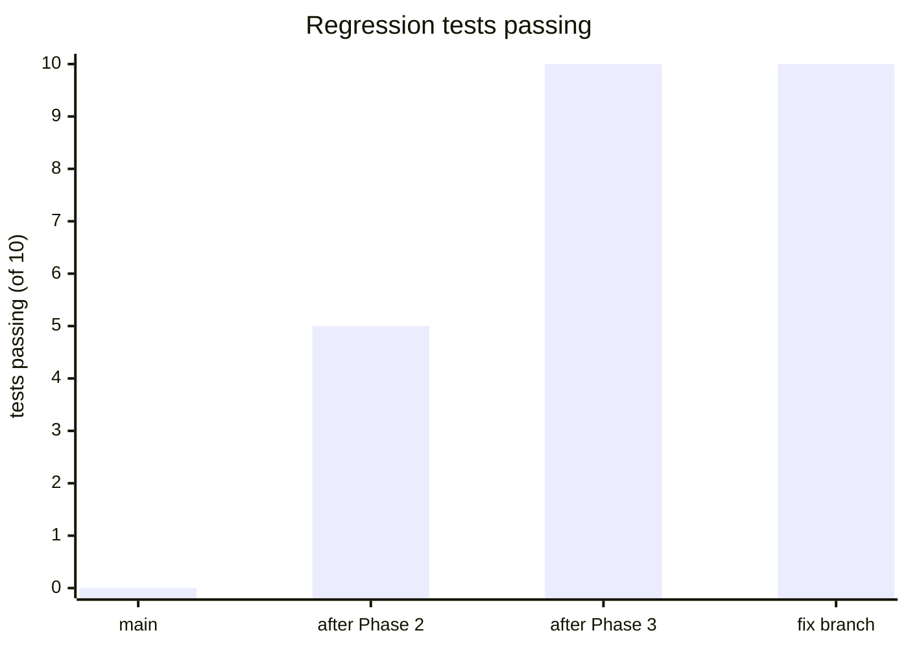
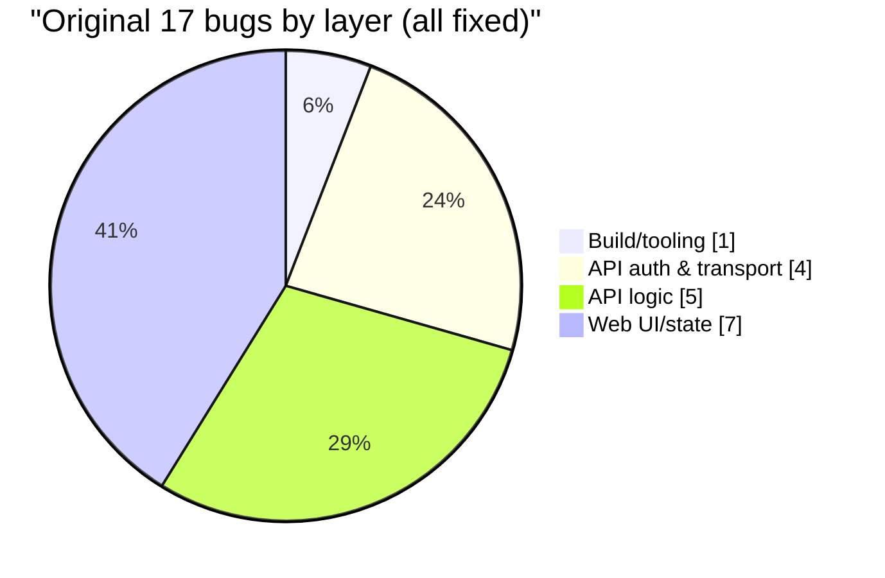
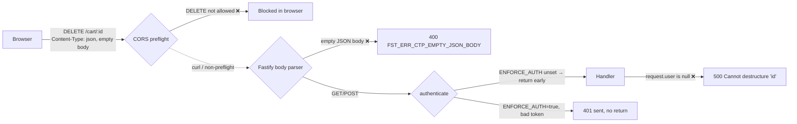
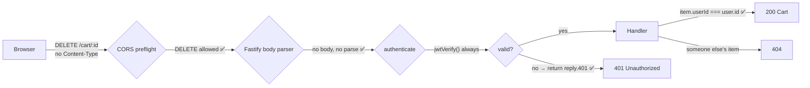
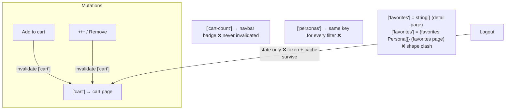
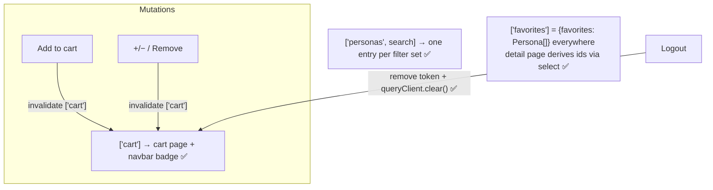
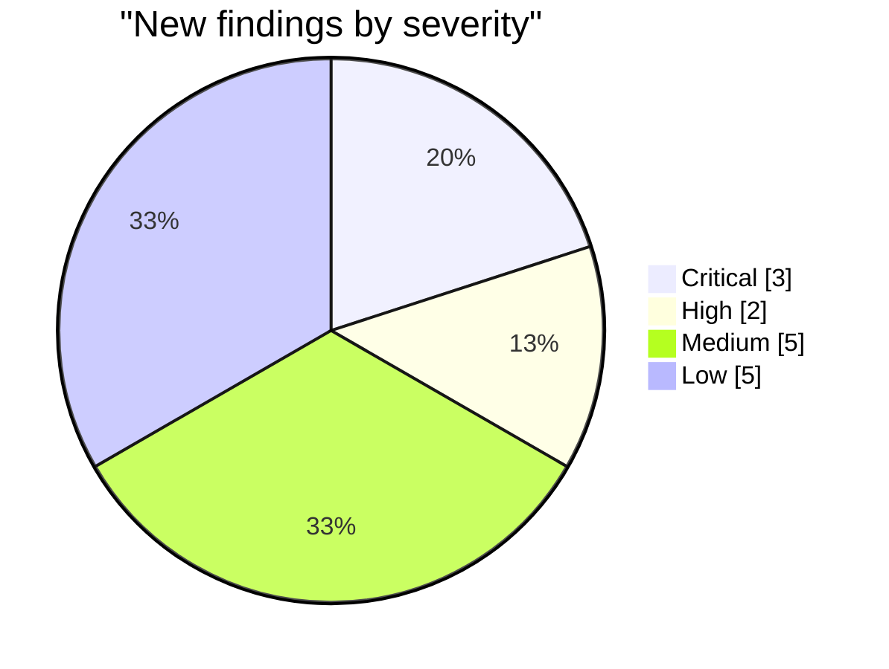

# Second-Pass Review — Agentic Personas Storefront

A second look at `fix/storefront-bugs`, written from a devil's-advocate angle. It has three parts:

1. [Before / after graphs](#1-before--after) for the 17 fixes
2. [Critique of our own changes](#2-devils-advocate-on-our-own-changes): what is weak or untested, and what the README got wrong
3. [New bugs found](#3-new-findings-beyond-the-original-17) beyond the original 17. Each one was **reproduced** with `fastify.inject`, a browser run, or a `main`-vs-branch A/B test. None of them are guesses.

---

## 1. Before / after

### 1.1 Health scorecard

| Check | `main` | `fix/storefront-bugs` |
|---|---|---|
| `pnpm build` | ✅ 3/3 | ✅ 3/3 |
| `pnpm typecheck` | ❌ `@acme/web` TS4023 | ✅ 4/4 |
| `pnpm test` (10 API regression tests) | ❌ 0 / 10 (no harness existed) | ✅ 10 / 10 |
| Protected routes with a valid token | ❌ 500 | ✅ 200 |
| Protected routes with no token | ❌ 500 | ✅ 401 |
| Browser `DELETE` (remove item / unfavorite) | ❌ CORS + empty-body 400 | ✅ 200 |

### 1.2 Request path for a protected route

**Before:**

**After:**

### 1.3 Frontend cache keys (TanStack Query)

**Before:** the badge never refreshes, search results stay stale, and the `["favorites"]` key holds two different data shapes.

**After:**

### 1.4 Diff footprint

The fixes are small. Most of the added lines are the new test harness.

| Area | Files | +/− |
|---|---|---|
| API source | 7 (+1 new `app.ts`) | +41 / −41 |
| API tests | 1 new | +176 |
| Shared | 1 new schema + index | +12 |
| Web | 7 | +13 / −10 |

---

## 2. Devil's advocate on our own changes

| # | Concern | Verdict |
|---|---|---|
| C1 | **Bug 3 was overstated.** The README said the handler "still runs" after the 401. I rebuilt the original hook (send without `return`) on Fastify 5 and got `401` with `handlerRan: false`. Fastify 5 sees that the reply was already sent from an async hook and stops there. | The `return reply` fix is still correct and good hygiene, but the bug **can't be reproduced** on this Fastify version. README corrected. |
| C2 | **The Bug 3 test can't tell the difference.** It passes with or without the `return`, so it doesn't actually guard the fix. | Gap. To really test it, the test would need a spy on the handler, or an older Fastify. |
| C3 | **The Bug 17 test checks the server, not the fix.** The fix lives in `apps/web/src/lib/api.ts`. The test only shows that Fastify rejects an empty JSON body. No test runs the client wrapper. | Gap. The web app has no test runner. A small vitest + `fetch` mock test for `request()` would close it. |
| C4 | **Tests share global state.** `db.ts` keeps module-level `Map`s, and `buildApp()` doesn't create a fresh store. Tests stay independent only because each one registers a new user. | This works but is brittle. A later improvement would be to inject a `db` into `buildApp()`. |
| C5 | **Removing `ENFORCE_AUTH` changes behavior.** Anyone who used the app without logging in during development now gets 401s. | Intended, since the bypass was the bug. It is documented. |
| C6 | **The Bug 6 fix assumes nothing in between can fail.** If a cart line points to a persona that no longer exists, checkout skips it (`continue`) and still clears the whole cart, so that line disappears. | Can't happen with seeded data. Noted as an edge case. |
| C7 | **An 18th bug was fixed by accident.** Moving the detail page's favorites query to `select` also fixed a crash that already existed (see N11). | Good outcome, but the plan didn't anticipate it. It is now documented. |
| C8 | **README errors from the first pass.** Bug 2 listed a `/orders` route and Bug 6 mentioned "stock decremented / inventory". Neither exists in this codebase. | Corrected. |

---

## 3. New findings beyond the original 17

Severity reflects impact if this ran anywhere other than a laptop. Every row was reproduced. The **Repro** column shows the evidence.

### 3.1 Summary

| ID | Sev | Area | Finding | Repro (observed) |
|---|---|---|---|---|
| N1 | 🔴 Critical | API auth | **Password hash collisions.** `simpleHash` is a 32-bit Java-style `hashCode`, so `"Aa"` and `"BB"` hash to the same value. | Registered with `AaAaAa`, logged in with `BBBBBB` → **200**. |
| N2 | 🔴 Critical | API auth | **Old tokens log in as a different user after a restart.** User ids are a counter (`user-1`, `user-2`, …), the store is in memory, and the JWT never expires. After a restart the ids are handed out again. | Alice's pre-restart token → `/auth/me` returned **`mallory`**. |
| N3 | 🔴 Critical | API auth | **Anyone can forge tokens.** The JWT secret is hard-coded in the repo, tokens have no `exp`, and `authenticate` never checks that the user exists. | A signed token for nonexistent `user-999` → `POST /cart` **200**. (`/auth/me` returns 404, so the token is accepted for writes but not for reads.) |
| N4 | 🟠 High | API validation | **A repeated query parameter crashes the search.** `?q=a&q=b` makes `q` an array, and `.toLowerCase` throws. `personaFilterSchema` exists in `@acme/shared` but is **never used**. | `GET /personas?q=a&q=b` → **500** `filters.q.toLowerCase is not a function`. |
| N5 | 🟠 High | API validation | **Quantity has no upper limit.** `addToCartSchema` only sets `min(1)`, and `cart.add` keeps adding to the existing quantity. | `quantity: 1e15` → cart `total: 99990000000000000`. |
| N6 | 🟡 Medium | Web UX | **Validation errors show as `[object Object]`.** The API returns `error: zodError.flatten()`, which is an object, and `ApiError` passes it to `new Error(...)`. This affects register, login, checkout, and cart. | Checkout with `novalidate` and a bad email → red text **`[object Object]`**. |
| N7 | 🟡 Medium | Web auth | **Logged-in users briefly see the logged-out UI on reload.** `AuthProvider` exposes `isLoading`, but **no component reads it**, so pages and the nav render as logged-out until `/auth/me` returns. | With `/auth/me` delayed 1.5 s, `/cart` showed "Sign in to view your cart" and the nav showed "Sign in / Sign up". The real cart appeared afterward. |
| N8 | 🟡 Medium | API data | **Emails are case-sensitive.** `Case@x.dev` and `case@x.dev` register as two separate accounts. | Both registrations → **201, 201**. |
| N9 | 🟡 Medium | Web auth | **A token that dies mid-session goes unnoticed.** Only the startup `/auth/me` call clears an invalid token. Any later 401 just shows as an error while the UI still looks logged in. | Code inspection plus N2: after an API restart the UI stays "logged in" and every cart call fails. |
| N10 | 🟡 Medium | Web | **No root `errorComponent`.** Any render error shows TanStack's raw dev screen: "Something went wrong!" with a stack trace. | Seen while reproducing N11 on `main`. |
| N11 | ⚪ Low (fixed) | Web cache | **The `["favorites"]` key held two data shapes.** The detail page stored `string[]` and the favorites page stored `{favorites}`. Going Favorites → detail **crashed the page**. Fixed on the branch by C7. | On `main`: Favorites → Browse → Refactor Rex → **`TypeError: favorites.includes is not a function`**. On the branch it renders. |
| N12 | ⚪ Low | Web/API | **Non-numeric price filters are handled differently by the API and the web app.** The API turns `maxPrice=abc` into `NaN` and returns `[]`. The web app silently drops it and shows all 15. `maxPrice=0` is also dropped because of a truthiness check (`if (search.maxPrice)`). | `GET /personas?maxPrice=abc` → `[]`. UI `/?maxPrice=abc` → 15 cards. |
| N13 | ⚪ Low | Web UX | **Failed mutations on the detail page don't tell the user.** "Add to Cart" and the heart button have no `onError` and no pending state. | Code inspection. |
| N14 | ⚪ Low | Web cache | **Cached data isn't tied to a user.** Keys like `['cart']` and `['favorites']` don't include the user id. Our `logout()` clears the cache, but the 401 path in `AuthProvider` and `login()` don't. | Code inspection. Mostly covered by the Bug 15 fix. |
| N15 | ⚪ Low | API perf | **Every lookup scans all records.** `users.getByEmail` and `cart.getByUserId` loop over everything. Fine for a demo, but it gets slower as data grows. | Code inspection. |

### 3.2 Recommended fixes (not applied)

| ID | Fix |
|---|---|
| N1 | Use `bcrypt`/`argon2` (or at least `crypto.scrypt` with a salt) and compare with `timingSafeEqual`. |
| N2, N3 | Use `crypto.randomUUID()` for user ids, read the JWT secret from `process.env`, `sign(..., { expiresIn: "1h" })`, and have `authenticate` reject tokens whose `id` isn't in `db.users`. |
| N4, N12 | `personaFilterSchema.safeParse(request.query)` in `GET /personas` (it already exists and already uses `z.coerce.number()`). In `validateSearch`, use `Number.isFinite` instead of truthiness. |
| N5 | Add `.max(100)` to `addToCartSchema.quantity` and `updateCartItemSchema.quantity`, and cap the merged total in `cart.add`. |
| N6 | In `api.ts`: `typeof body.error === "string" ? body.error : body.error?.formErrors?.[0] ?? Object.values(body.error?.fieldErrors ?? {}).flat()[0] ?? "Invalid input"`. |
| N7 | In pages that require a login, render a skeleton while `isLoading` is true. Do the same for the nav. |
| N8 | Lower-case emails in the Zod schema (`z.string().email().toLowerCase()`). |
| N9, N14 | Handle 401 in one place: on any 401 from `request()`, call `logout()` (for example through an event or callback that `AuthProvider` registers). Also clear the cache in `login()`. |
| N10 | Add `errorComponent` to the root route. |
| N13 | Add `onError` toasts and disable buttons while `isPending`. |

---

## 4. Method

- API findings come from throwaway `tsx` scripts that call `buildApp({ logger: false })` and `app.inject()`. The scripts were deleted afterward.
- N2 ran two separate API processes in a row to simulate a restart.
- UI findings come from Playwright against `pnpm dev`. N7 used `page.route` to delay `/auth/me`.
- N11 was an A/B test: `main`'s `$personaId.tsx` was temporarily checked out, the crash reproduced, then the file was restored. The branch is clean.
- The `🤖`-style text seen in PowerShell output was a **console display issue**. The emoji render correctly in the browser and are **not** a bug.
